# Three-surface PrettyText comparison

Current source: `0f690f0de444d9398a87abcb085515dc84484a6d`. The playground dialog and its dedicated tests are excluded from the PR.

These images were captured from clean upstream `d0dc9e5ff` **without PR** and `69d3486d3` **with PR**. The three retained surfaces and fresh main-app entry bytes are unchanged at current head; these are reused images, not a claimed recapture. See [validation and scope report](REPORT.md), [source proof](source-proof.json), and [asset proof](asset-proof.json).

All primary pairs share frozen fixtures, theme, 1440×1000 viewport, 100% zoom, UTC/fixed clock, and matched table width/sort/scroll. The folder contains 40 primary screenshots and four explicitly supplemental tooltip-scroll images. No dialog/harness images are included.

## Dark theme

### Annotation explanations

| Without PR | With PR |
| --- | --- |
| 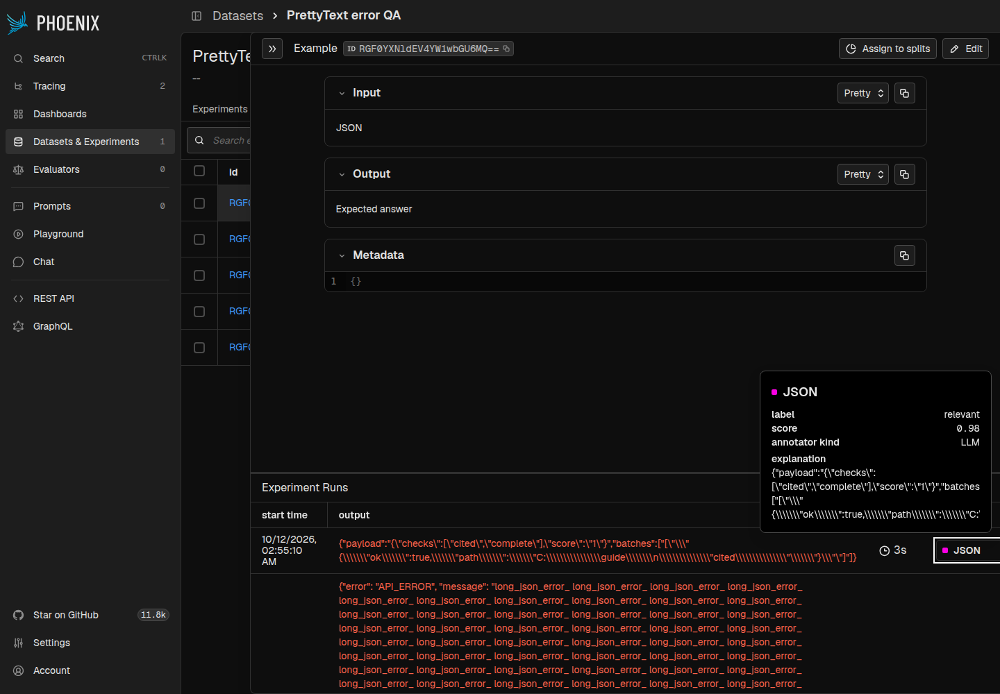 | 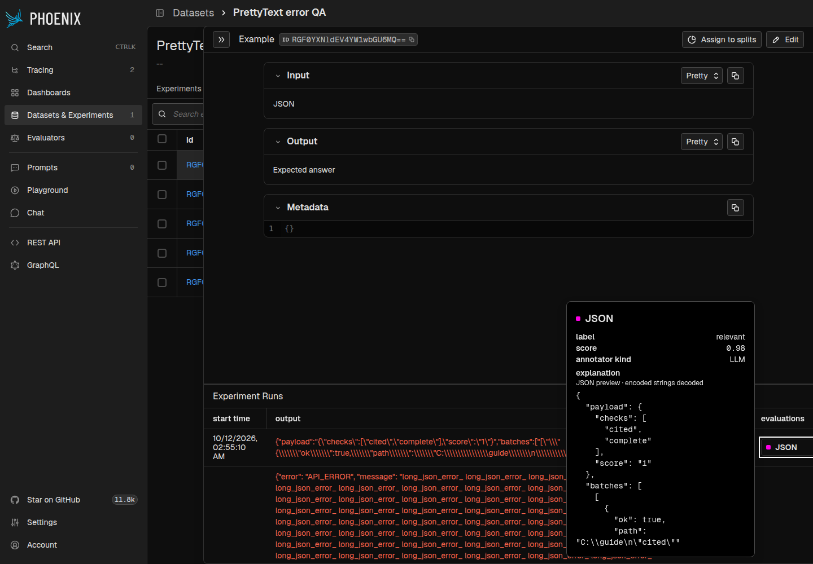 |

### Span feedback table

| Without PR | With PR |
| --- | --- |
| 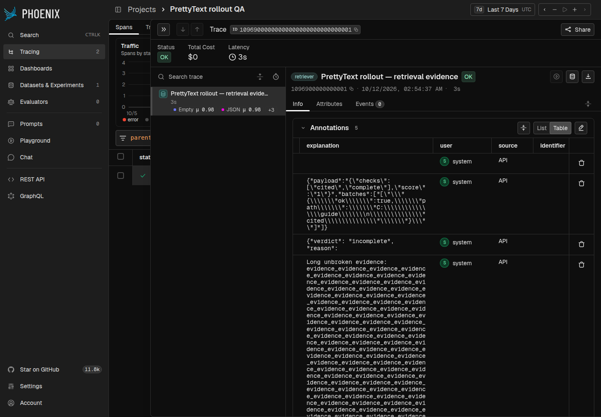 | 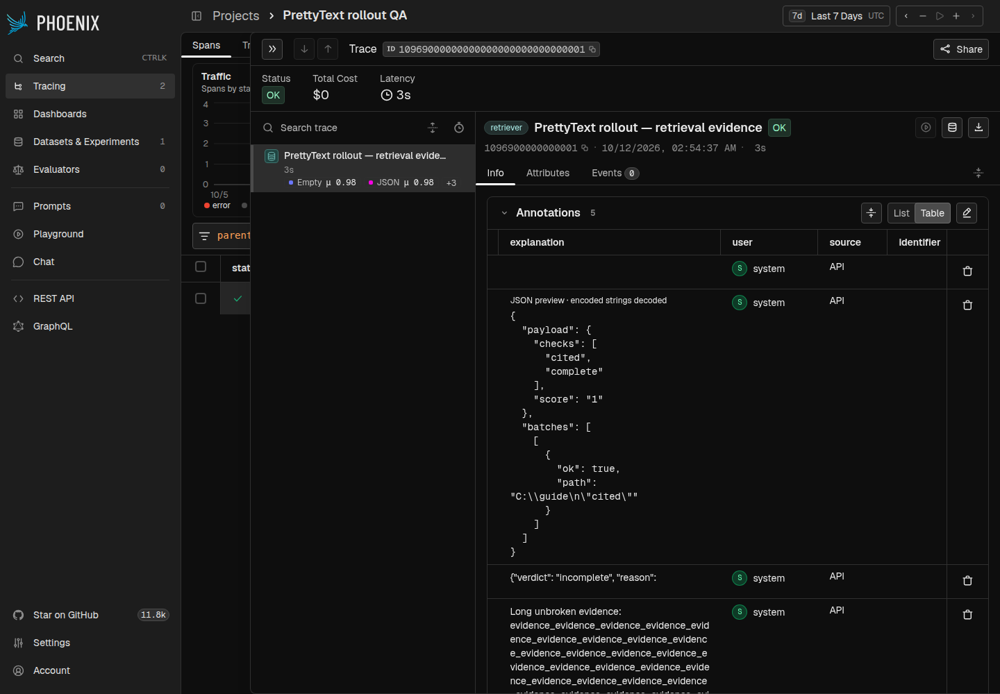 |

### Document evaluation explanations

| Without PR | With PR |
| --- | --- |
| 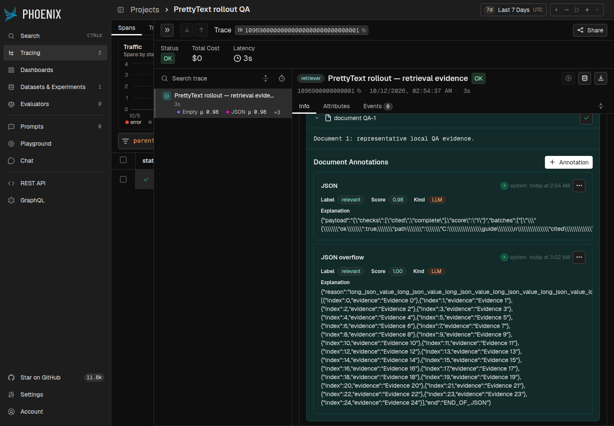 | 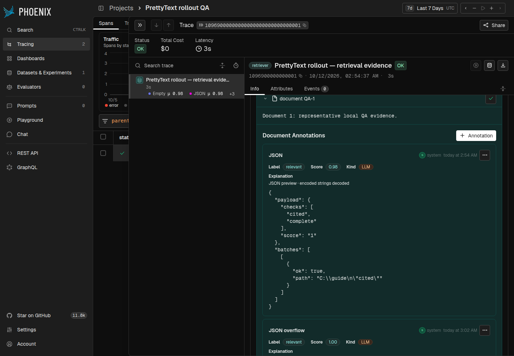 |

## Light theme

### Annotation explanations

| Without PR | With PR |
| --- | --- |
| 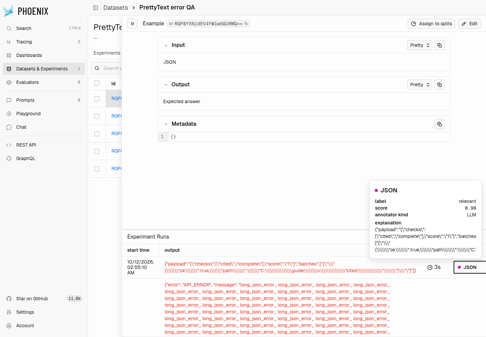 | 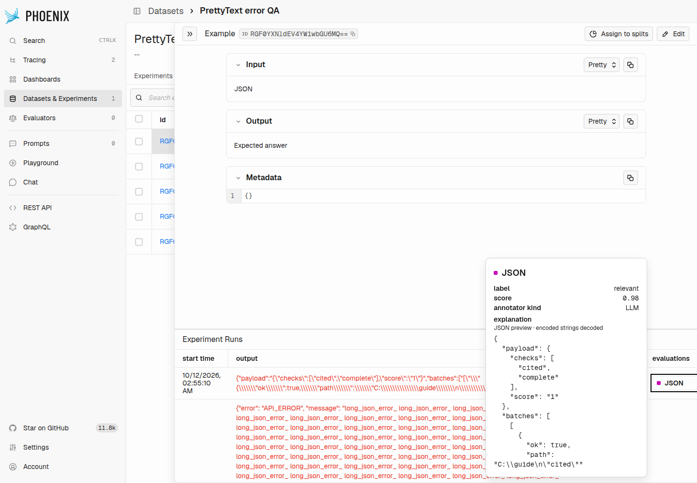 |

### Span feedback table

| Without PR | With PR |
| --- | --- |
| 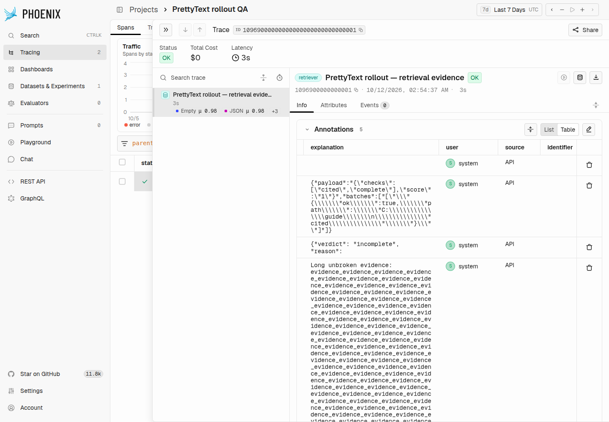 | 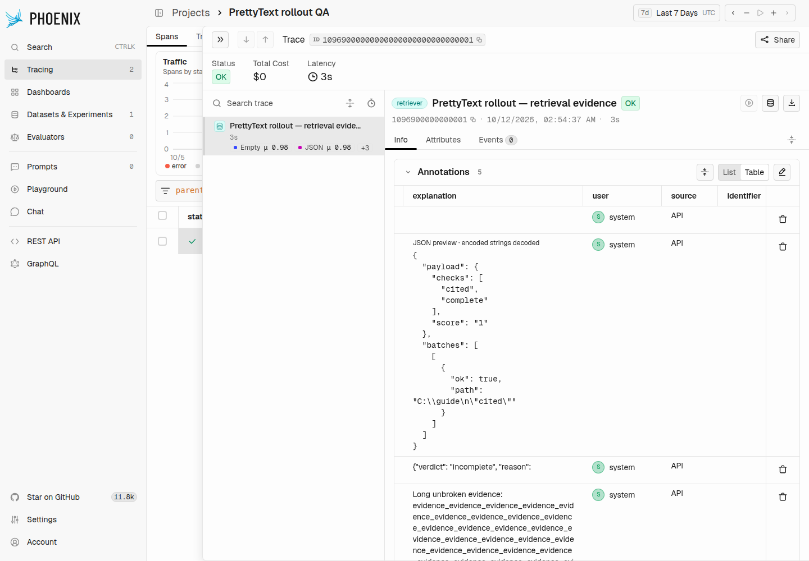 |

### Document evaluation explanations

| Without PR | With PR |
| --- | --- |
| 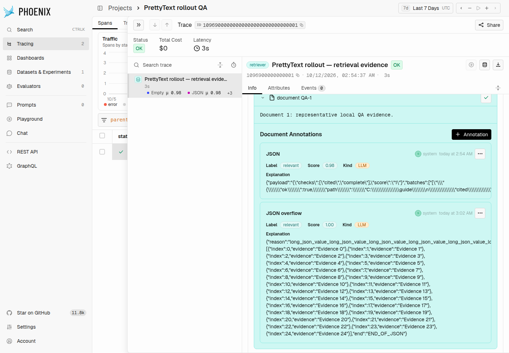 | 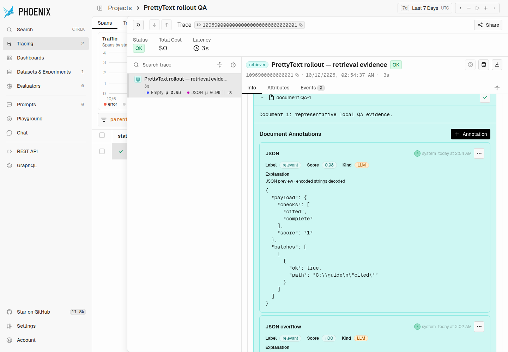 |

## Controls and supplemental evidence

Each side/theme also contains `annotation-plain.png`, `annotation-malformed.png`, `table-plain.png`, `table-malformed.png`, `table-collapsed.png`, `document-plain.png`, and `document-malformed.png`.

`annotation-json-bottom.png` is supplemental real pointer-wheel end-of-scroll evidence, not a primary initial-state pair and not a keyboard-scrolling fix. The existing bounded-tooltip keyboard limitation is unchanged.
